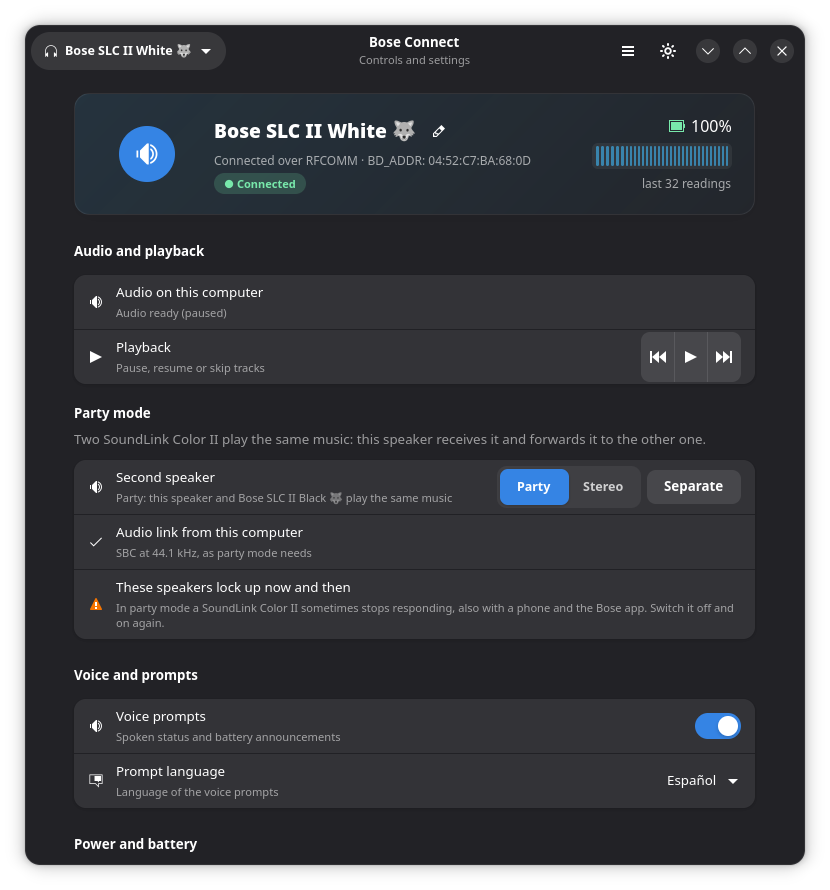

# Bose® Connect App for Linux

> **Not an official app.**

A desktop app, a command-line tool and a Rust library to control
Bose Bluetooth headphones and speakers from Linux.

If you own a Bose device, you'll know that the **Bose Connect** app
is not available on Linux. This project speaks the same RFCOMM
protocol as the official app, so the device can be controlled from
Linux: battery, name, auto-off, voice prompts, noise cancelling or
audio modes, equalizer, paired sources, volume and media keys.



The project is written in Rust. It started as a fork of
[Denton-L/based-connect][denton-l], a C program under the GPL-3.0.
The code has since been rewritten and extended, and that project
remains its inspiration. This project is licensed under the
AGPL-3.0-or-later (see [`LICENSE`](LICENSE)). The last C version is
in the [`main`][main-branch] branch's history
(`git log --follow src/library/based.c`).

## Repository layout

```text
.
├── Cargo.toml                # workspace manifest
├── crates/
│   ├── bose-connect/         # library crate (Rust API + C FFI)
│   │   ├── src/
│   │   │   ├── lib.rs        # public Rust API
│   │   │   ├── connection.rs # RFCOMM socket layer
│   │   │   ├── protocol.rs   # Bose Connect protocol commands
│   │   │   ├── io.rs         # transport-agnostic IO trait
│   │   │   ├── types.rs      # enums + BdAddr + Device
│   │   │   ├── error.rs      # BoseError + thiserror
│   │   │   ├── util.rs       # hex / byte helpers
│   │   │   ├── address.rs    # Bluetooth address parsing
│   │   │   ├── ffi.rs        # C ABI surface (cfg(feature = "ffi"))
│   │   │   └── bin/probe.rs  # sanity-probe binary
│   │   ├── tests/
│   │   │   └── protocol_roundtrip.rs  # UnixStream-backed round-trip tests
│   │   ├── cbindgen.toml     # C header generation config
│   │   └── build.rs          # cbindgen invocation
│   └── bose-connect-cli/     # binary crate
│       └── src/main.rs       # clap-based CLI
└── .github/workflows/        # CI / CD / release
```

## Quick start

### Library (`bose-connect`)

Add to your `Cargo.toml`:

```toml
[dependencies]
bose-connect = "0.1"
```

Use the high-level `BoseDevice` driver:

```rust
use bose_connect::{BoseDevice, PromptLanguage};

let mut device = BoseDevice::open("AA:BB:CC:DD:EE:FF")?;
println!("Battery: {}%", device.battery_level()?);
device.set_language_keep_voice_prompts(PromptLanguage::En)?;
```

Or drop down to the protocol layer directly:

```rust
use bose_connect::protocol;

let mut device = BoseDevice::open("AA:BB:CC:DD:EE:FF")?;
let (device_id, index) = protocol::get_device_id(device.connection())?;
let firmware = protocol::get_firmware_version(device.connection())?;
```

### CLI (`bose-connect-app-linux`)

Build from source:

```bash
cargo install --path crates/bose-connect-cli
```

Then run it; every flag of the C version is still accepted:

```text
Usage: bose-connect-app-linux [OPTIONS] <ADDRESS>

Arguments:
  <ADDRESS>  Bluetooth address of the Bose device ("AA:BB:CC:DD:EE:FF")

Options:
  -h, --help     Print help
  -V, --version  Print version

Device information:
  -i, --info              Print all device information
  -d, --device-status     Print the device status (name, language, voice-prompts, auto-off, NC)
  -f, --firmware-version  Print the firmware version
  -s, --serial-number     Print the serial number
  -b, --battery-level     Print the battery level as a percent
      --device-id         Print the device id and index revision
      --device-bd-addr    Print the device's BT address
      --audio-state       Print how BlueZ sees the device's audio link to this computer, without opening a Bose connection

Sound:
  -m, --audio-mode <MODE>          Switch the audio mode (QC Ultra, QC45). mode: its name (quiet, aware, immersion, …) or its slot index
  -c, --noise-cancelling <LEVEL>   Change the noise-cancelling level. level: high, low, off. On the QC Ultra and QC45, use --audio-mode instead. On the NC 700, level: off, high or 0..=10 (0 is off, as in the Bose Music app)
      --equalizer <BANDS>          Set equalizer bands (QC Ultra, QC45, NC 700), e.g. `bass=4,mid=0,treble=-3`. Each in -10..=10
      --immersive-audio <SETTING>  Immersive audio (QC Ultra). setting: off, still, motion
  -e, --self-voice <LEVEL>         Change the self-voice level. level: high, medium, low, off
      --nc-favorites <LEVELS>      Set the three noise-cancelling favourites (NC 700), e.g. `10,5,0` (0 is off, 10 is the strongest)

Playback:
      --set-volume <LEVEL>    Set the volume. The range is device-specific (e.g. 0..=25 on a QC35 II)
      --send-media-key <KEY>  Send a media key. key: pause (play/pause), next, prev
      --active-device         Print the active audio source's BT address

Settings:
  -n, --name <NAME>               Change the device name
  -o, --auto-off <MINUTES>        Change the auto-off time. minutes: never, 5, 20, 40, 60, 180, or 1440 (24 hours, QC Ultra only)
  -l, --prompt-language <LANG>    Change the prompt language
  -v, --voice-prompts <SWITCH>    Toggle voice prompts. switch: on, off
      --battery-prompt <SWITCH>   Announce the battery level at power-on (QC Ultra). switch: on, off
      --auto-play-pause <SWITCH>  Pause when the headphones come off and resume when they go on (QC Ultra). switch: on, off
      --auto-answer <SWITCH>      Answer calls by putting the headphones on (QC Ultra). switch: on, off
      --remember-mode <SWITCH>    Start in the last audio mode used (QC Ultra, QC45) or at the last noise-cancelling step (NC 700). switch: on, off
      --motion-auto-off <SWITCH>  Switch off after an hour without motion (NC 700). switch: on, off
      --shortcut <ACTION>         Touch-and-hold shortcut of the right earcup (QC Ultra, QC45, NC 700). action: battery, immersive, assistant, spotify, wake-word (NC 700), off

Advanced:
      --watch <SECONDS>    Print what the device sends on its own (button presses, battery, setting changes) for this many seconds
      --channel <CHANNEL>  RFCOMM channel to use instead of the automatic choice (8, then 2, then 1)
      --send-packet <HEX>  Send a raw hex packet (e.g. `0a1b2c3d`) and print the response

Paired devices:
  -a, --paired-devices               Print the list of paired devices
      --connect-device <ADDRESS>     Connect to the device at the given Bluetooth address
      --disconnect-device <ADDRESS>  Disconnect the device at the given Bluetooth address
      --remove-device <ADDRESS>      Remove the device at the given Bluetooth address from the pairing list
  -p, --pairing <STATUS>             Toggle pairing discoverability. status: on, off

Party mode (SoundLink Color II):
      --party-join <SPEAKER>    Join the SoundLink Color II at the given address to this one (party mode). The other speaker must be on and paired with this one. Stop the music for a minute before joining when this computer is the source; see the README
      --party-source <ADDRESS>  Music source for `--party-join` (default: this computer's Bluetooth adapter). Give the phone's address when the phone plays the music
      --party-leave <SPEAKER>   Separate the joined speaker at the given address
      --party-mode <MODE>       Print or switch the party mode. mode: status, party, stereo
```

When a device is connected but this computer has no audio stream to
it, `--audio-state` (and the GUI) suggest disconnecting and connecting
again from this computer. On some systems, when the headphones start
the connection themselves, BlueZ fails to open the audio stream.

### C / FFI

The library ships a stable C ABI through the `ffi` feature
(default-on). The header is auto-generated by `cbindgen` into
`crates/bose-connect/bose_connect.h` at build time:

```bash
cargo build -p bose-connect
ls crates/bose-connect/bose_connect.h
```

Build a shared library for non-Rust consumers:

```bash
cargo build --release -p bose-connect \
  --crate-type cdylib

# The resulting .so is at target/release/libbose_connect.so
```

## Build and Installation

### Dependencies

* Rust toolchain (1.85 or newer; tested on stable)
* `pkg-config`
* BlueZ headers
    * `bluez-libs` on Arch Linux
    * `libbluetooth-dev` on Debian and Ubuntu

The Rust crate builds on Linux without the BlueZ headers — it
calls the kernel through `libc::connect` directly. The headers are
required only for downstream C/C++ projects that include the
generated header in environments without the BlueZ userspace
headers installed.

### Local

```bash
# Run the CI gauntlet locally (matches .github/workflows/ci.yml).
cargo fmt --all -- --check
cargo clippy --workspace --all-targets -- -D warnings
cargo test --workspace --all-targets
cargo doc --no-deps --workspace
cargo build --workspace --release --locked

# Smoke-test the binary.
./target/release/bose-connect-app-linux --help
```

### Docker

There is no Docker image yet (tracked in `TODO.md`). Install the
toolchain locally.

## CI/CD

The `.github/workflows/` directory contains:

| File              | Purpose                                                  |
| ----------------- | -------------------------------------------------------- |
| `ci.yml`          | Rust CI: fmt, clippy, test, doc, release build          |
| `codeql.yml`      | GitHub CodeQL security analysis                          |
| `cargo-audit.yml` | RustSec advisory scanner, nightly                        |
| `release.yml`     | Tag-triggered release: crates.io publish + GitHub release with binary artefacts |

## Coming from the C version

| C source file       | Rust counterpart                                      |
| ------------------- | ----------------------------------------------------- |
| `src/main.c`        | `crates/bose-connect-cli/src/main.rs`                 |
| `src/library/based.c` | `crates/bose-connect/src/protocol.rs`               |
| `src/library/bluetooth.c` | `crates/bose-connect/src/connection.rs` (+ `address.rs`) |
| `src/library/util.c` | `crates/bose-connect/src/util.rs`                    |
| `src/library/based.h` (enums) | `crates/bose-connect/src/types.rs`     |

The commands of the C version send the same bytes, except where a
capture on a real device showed that the C bytes were wrong; replies
are read from their header instead of fixed-size acknowledgements.
[`docs/protocol.md`](docs/protocol.md) records each case.

## QuietComfort Ultra Headphones

The QC Ultra Headphones (device id `0x4066`) speak the same
protocol on RFCOMM channels 2 and 1 instead of 8, one client per
channel; the phone's Bose app holds one of them. The connection falls
back to 2, then 1, automatically (`--channel` forces one). Their audio
modes replace the noise-cancelling levels:

```bash
# mode: quiet, aware, immersion, or a slot index
bose-connect-app-linux AA:BB:CC:DD:EE:FF --audio-mode aware
```

Supported: `--info`, `--device-status` (including the audio mode
and the settings below), `--firmware-version`, `--serial-number`,
`--battery-level`, `--paired-devices`, `--device-id`,
`--audio-mode`, `--self-voice`, `--auto-off` (also `1440`, 24 hours),
`--voice-prompts`, `--set-volume` (0 to 31) and
`--send-media-key next|prev`. Settings only the QC Ultra has:

```bash
bose-connect-app-linux AA:BB:CC:DD:EE:FF --equalizer bass=4,treble=-3   # -10..=10
bose-connect-app-linux AA:BB:CC:DD:EE:FF --immersive-audio still       # off, still, motion
bose-connect-app-linux AA:BB:CC:DD:EE:FF --battery-prompt off          # on, off
bose-connect-app-linux AA:BB:CC:DD:EE:FF --auto-play-pause on          # on, off
bose-connect-app-linux AA:BB:CC:DD:EE:FF --auto-answer off             # on, off
bose-connect-app-linux AA:BB:CC:DD:EE:FF --remember-mode on            # on, off
bose-connect-app-linux AA:BB:CC:DD:EE:FF --shortcut immersive          # battery, immersive, assistant, spotify, off
```

Refused on purpose: `--prompt-language` (the language write is
untested there) and `--send-media-key pause` (on firmware 1.6.7 it
locks media control until the phone reconnects). See
[`docs/protocol.md`](docs/protocol.md) for the captures.

## NC 700 Headphones

The NC 700 Headphones (device id `0x4024`) use RFCOMM channel 8 and
the stepped noise cancelling of the Bose Music app. `--noise-cancelling`
takes the app's number, `0` (off) to `10` (the strongest), or `off` and
`high`; the headphones count the other way round on the wire and the
library converts. It answers neither `--audio-mode` nor the QC35's
low/high levels.

```bash
bose-connect-app-linux AA:BB:CC:DD:EE:FF --noise-cancelling 5          # off, high or 0..=10
bose-connect-app-linux AA:BB:CC:DD:EE:FF --nc-favorites 10,5,0         # 0..=10, three values
bose-connect-app-linux AA:BB:CC:DD:EE:FF --remember-mode on            # last noise-cancelling step
bose-connect-app-linux AA:BB:CC:DD:EE:FF --motion-auto-off on          # on, off
bose-connect-app-linux AA:BB:CC:DD:EE:FF --shortcut wake-word          # battery, spotify, wake-word, off
bose-connect-app-linux AA:BB:CC:DD:EE:FF --equalizer bass=4,treble=-3  # -10..=10
bose-connect-app-linux AA:BB:CC:DD:EE:FF --watch 60                    # live changes for 60 s
bose-connect-app-linux AA:BB:CC:DD:EE:FF --pairing on                  # on, off
```

`--watch` shows a button press only through what it changes (the noise
cancelling or the volume): the NC 700 sends no key-press packets.

Also supported: `--info`, `--device-status` (which prints the noise
cancelling, favourites, equalizer, shortcut and the two switches),
`--self-voice`, `--auto-off` (5, 20, 40, 60, 180 minutes or never; only
20 and never were written on hardware), `--voice-prompts`,
`--set-volume` (0 to 16) and `--paired-devices`.
Not supported by the headphones: on-head detection, LED brightness,
auto play/pause and audio modes. See
[`docs/protocol.md`](docs/protocol.md) for the captures.

## SoundLink Color II: party and stereo mode

Two SoundLink Color II speakers can play the same music. The speaker
you talk to receives it and forwards it to the other one; in stereo
mode it plays the left channel and the other speaker the right one.

```bash
bose-connect-app-linux SPEAKER_1 --party-join SPEAKER_2   # "Party mode"
bose-connect-app-linux SPEAKER_1 --party-mode stereo      # status, party, stereo
bose-connect-app-linux SPEAKER_1 --party-leave SPEAKER_2  # "Speakers unlinked"
```

`--party-join` names this computer as the music source; with a phone
as the source, add `--party-source PHONE_ADDRESS`.

These speakers lock up now and then in party mode, also with the
phone and the Bose app; a locked-up speaker has to be switched off and
on. With this computer as the source, these steps made it work in the
tests (details in [`docs/protocol.md`](docs/protocol.md)):

1. Let the speaker connect its audio by itself (switch it on and wait):
   it then picks 44.1 kHz. When the computer opens the audio link it
   uses 48 kHz, and both tests at 48 kHz locked up a speaker.
2. Play nothing for about a minute, then join.
3. After every `--party-join`, `--party-mode` and `--party-leave`
   the speaker goes silent until the computer restarts its audio
   stream:

   ```bash
   SINK=bluez_output.AA_BB_CC_DD_EE_FF.1   # see `pactl list sinks short`
   pactl suspend-sink "$SINK" 1 && pactl suspend-sink "$SINK" 0
   ```

Each command opens one connection, and the speaker switches itself off
after its 9th connection since power-on; see the speaker's notes in
`docs/protocol.md`.

## Disclaimer

This has only been tested on Bose `QuietComfort 35's` with
firmware 1.3.2, 1.2.9, 1.06, `QuietComfort 35 II` with firmware
4.8.1, `SoundLink II's` with firmware 2.1.1, `SoundLink Color II`
with firmware 4.0.1, `QuietComfort Ultra Headphones` with
firmware 1.6.7, `QuietComfort 45` with firmware 4.0.4 and
`NC 700 Headphones` with firmware 1.8.2.
I cannot ensure that this program works on any
other devices.

## Trademark and affiliation notice

This is an independent, community-maintained project written so
that Linux can talk to Bluetooth audio devices their owners
already have. It is not affiliated with, endorsed, sponsored or
supported by Bose Corporation.

* "Bose", "Bose Connect", "QuietComfort" and "SoundLink" are
  trademarks of Bose Corporation. They are used here only to name
  the products this software works with.
* The repository contains no Bose source code, binaries, firmware
  images or keys. The protocol notes in
  [`docs/protocol.md`](docs/protocol.md) describe the packets the
  devices send and accept over RFCOMM, and the code that speaks
  them was written independently.

[denton-l]: https://github.com/Denton-L/based-connect
[main-branch]: https://github.com/airvzxf/bose-connect-app-linux/tree/main
